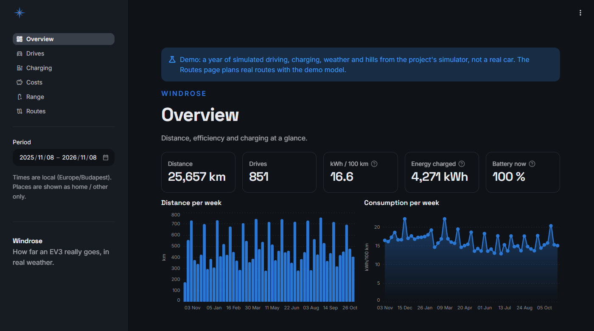
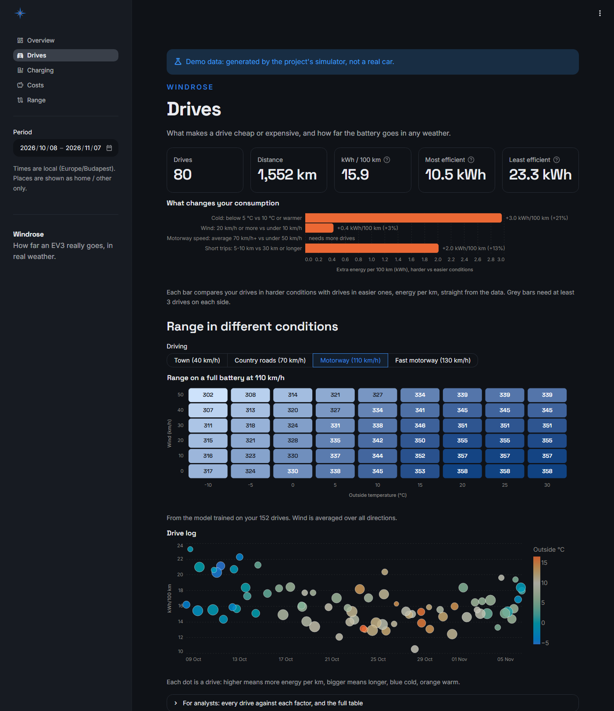
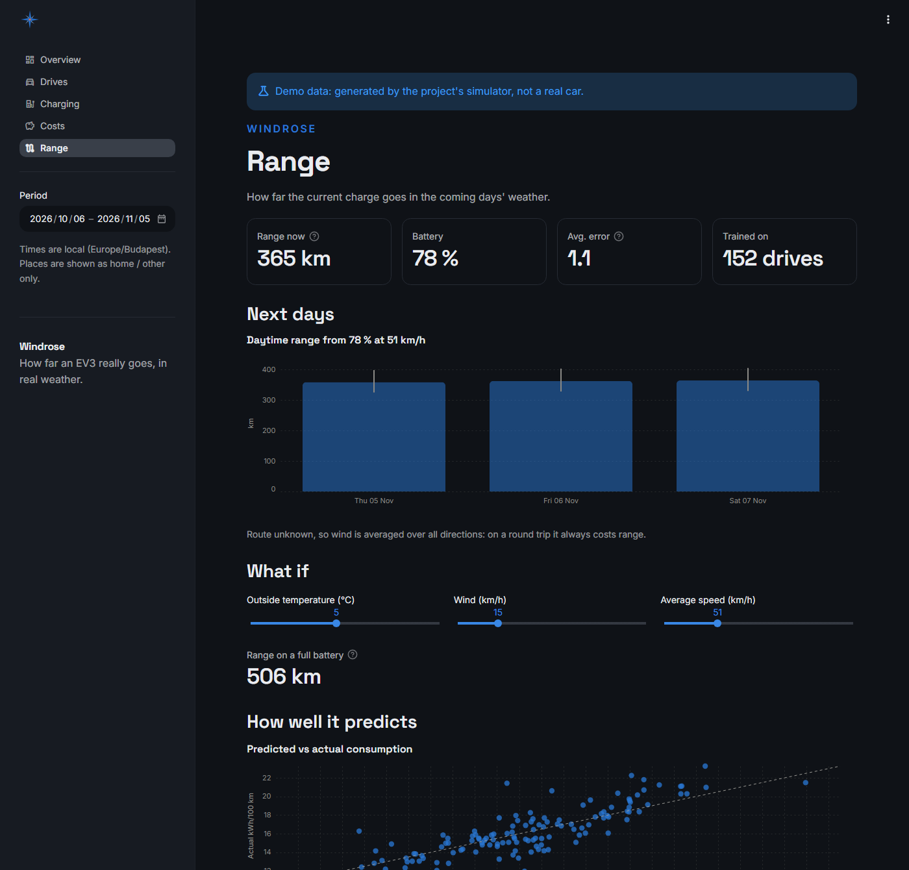
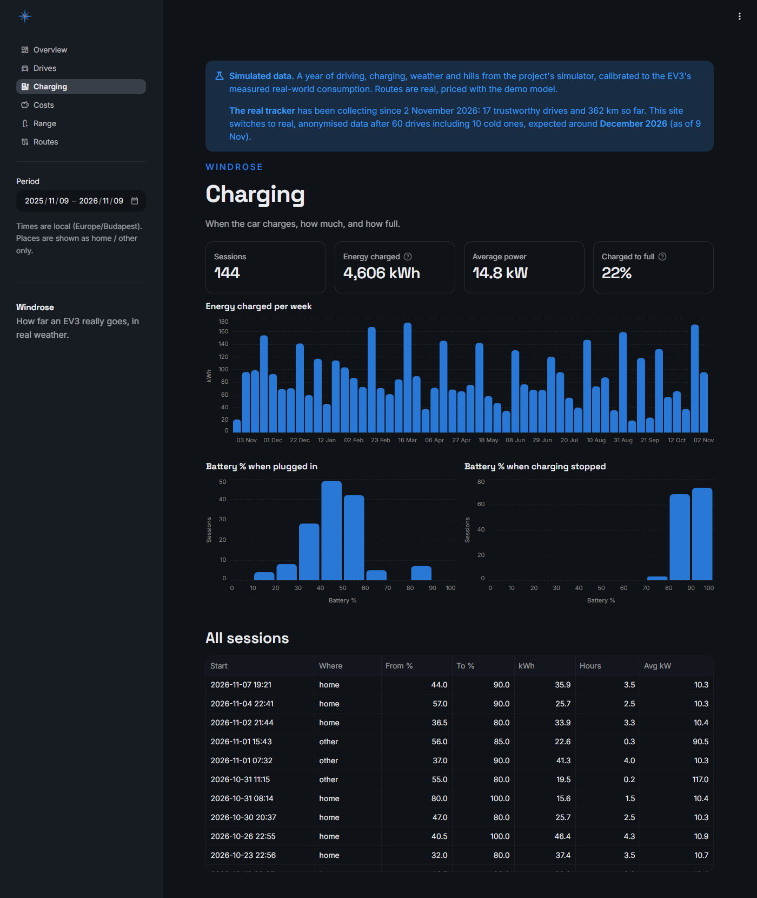
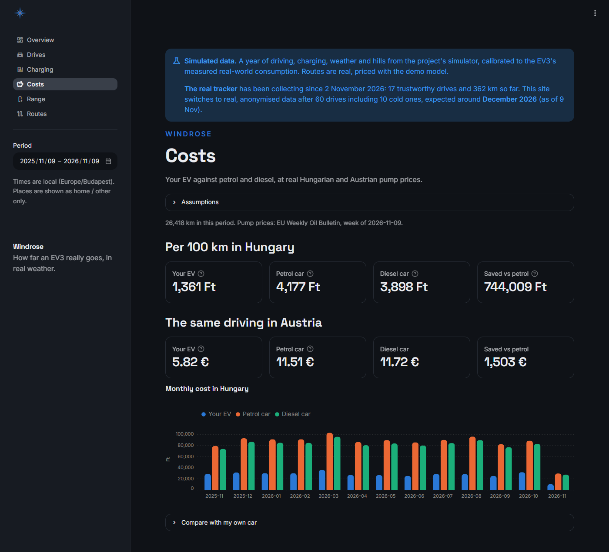

<p align="center"></p>

<h1 align="center">Windrose</h1>
<p align="center"><b>How far an EV3 really goes, in real weather.</b><br>
<sub>kiatracker: a personal data platform and range model for a Kia EV3</sub></p>

kiatracker collects a Kia EV3's own data through the official EU Data Act API, turns it into drives and
charging sessions, joins every stretch of every drive with its weather and terrain, and fits a
physics-informed model of what speed, cold, wind and hills cost. It then uses that model to forecast range and
to compare routes before you drive them.

> **Status:** collecting continuously on a Raspberry Pi. Done: data foundation, dashboard, weather- and
> terrain-aware range model, route comparison, model walkthrough notebook. Next: backups, plan-vs-actual for
> routes, and a public showcase. See the [roadmap](docs/roadmap.md).



## What it does

- **Collects** the car's battery, odometer, GPS, ignition and climate status: every minute while driving,
  every 5 minutes parked. Every response is kept as received.
- **Derives** drives, charging sessions and charge-to-charge windows, and flags drives whose energy can't be
  trusted (an unseen overnight charge, an impossible reading).
- **Explains consumption:** each stretch between GPS readings gets the hour's temperature and wind for its
  ~10 km cell, its headwind and its climb from terrain maps.
- **Models it** with five interpretable coefficients (base, air drag, heating, climbing, regeneration),
  starting from the car's specifications and learning from the drives as they come in. A time-ordered
  backtest decides how much to trust each.
- **Forecasts range** for the coming days' weather, and **compares routes**: energy by cause, arrival charge
  and how sure the answer is, for the hour you plan to leave.
- **Costs:** electricity against the same distance in a petrol car, at EU weekly fuel prices.

| | |
|---|---|
|  |  |
| **Drives:** what changes consumption, range in any conditions, the drive log and an analyst view. | **Range:** the next days' range in the forecast weather, with the model's evidence. |
|  |  |
| **Charging:** energy per week and where in the battery charging starts and stops. | **Costs:** what driving electric saved against petrol. |

All screenshots use the built-in simulator's demo data.

## Try it without a car

```bash
uv sync --extra dashboard
uv run kiatracker dashboard --demo
```

The dashboard opens at http://127.0.0.1:8501 on 60 days of simulated driving, charging and weather from a
simulator with known physics. The Routes page works too: it uses the demo model on real routes you type.

## Set up your own tracker

Works for Hyundai, Kia and Genesis cars sold in Europe with connected services (the API is the EU Data Act
access Hyundai Motor Group opened for owners). Nothing below costs money.

### What you need

- The car registered in your Kia Connect / Hyundai Bluelink / Genesis account.
- A machine that stays on: a Raspberry Pi 4 or 5 (64-bit OS), a home server, or any Docker host. A PC works
  but loses data while it's off.
- Docker with Compose on that machine; for local development, Python 3.13 and [uv](https://docs.astral.sh/uv/).
- Optional: [Tailscale](https://tailscale.com/) to open the dashboard from your phone.

### 1. Get an API key

Request a private Vehicle Data API key at
[Pleos](https://document.pleos.ai/en/api-reference/vehicle-data-api/getting-started/for-private-users/request-my-vehicle-api-key)
(Workspace → My Vehicle Data API). You get a client ID and a client secret.

### 2. Clone and configure

```bash
git clone https://github.com/DanielCsorba123/kiatracker.git
cd kiatracker
cp .env.example .env
```

Edit `.env`:

```ini
PLEOS_API_KEY_CLIENT_ID=...
PLEOS_API_KEY_CLIENT_SECRET=...
# optional: label drives and charging "home" / "other"
KIATRACKER_HOME_LAT=...
KIATRACKER_HOME_LON=...
```

`.env` and `data/` are gitignored. Never commit them.

### 3. Check the connection

```bash
uv sync
uv run kiatracker collect
```

One poll; it prints a summary such as
`SOC 80.0% notCharging, odo 12345.6, ignition off, new: batteries, driving, locations, status` (never
coordinates).
The first call also stores the last days of trips.

### 4. Run it always on (Docker, e.g. a Raspberry Pi)

```bash
docker compose --profile collector up -d collector dashboard
docker compose logs -f collector
```

- `collector` runs `kiatracker scheduler`: a poll every minute while the car is on and every 5 minutes
  otherwise, plus an hourly refresh (weather, forecast, fuel prices, terrain tiles, rebuild, retrain).
- `dashboard` serves your data at `http://127.0.0.1:8501` *on that machine only*, reading `data/` read-only.
- Both restart after a reboot. All state lives in `./data`.

To update later: `git pull && docker compose --profile collector up -d --build collector dashboard`.

<details>
<summary>On a Windows PC instead (Task Scheduler)</summary>

Create two tasks with **Start in** set to the project folder:

- every 5 minutes: `.venv\Scripts\pythonw.exe -m kiatracker collect`
- hourly: `.venv\Scripts\pythonw.exe -m kiatracker refresh`

Output goes to `data/logs/`. Readings are lost while the PC is off.
</details>

### 5. Open the dashboard

- **On the same machine:** `uv run kiatracker dashboard` (or the Docker service) → http://127.0.0.1:8501.
- **From your phone or laptop, privately:** install Tailscale on the host and your devices, enable *Serve* in
  the Tailscale admin console, then on the host:

  ```bash
  sudo tailscale serve --bg 8501
  ```

  The dashboard is then at `https://<host>.<tailnet>.ts.net`, reachable only by your own Tailscale devices.
  Don't publish the port on your router or LAN: the dashboard shows where you drive.
- **Ad hoc over SSH:** `ssh -L 8501:127.0.0.1:8501 you@host`, then http://127.0.0.1:8501.

### 6. Let the model learn

Consumption is measured for drives of 5 km or more. After 15 such drives the hourly refresh fits the model;
until it beats the car's specifications in the backtest, the app uses the specifications. Check progress:

```bash
uv run kiatracker train      # coefficients, backtest scores, chosen pull toward the specs
uv run kiatracker stats      # drives, charging, data quality
```

To explore the model yourself, run the walkthrough notebook on your data (see
[notebooks/model_walkthrough.ipynb](notebooks/model_walkthrough.ipynb): copy it to `*.local.ipynb` first).

### 7. Back it up

Everything is in `data/`: raw files (the irreplaceable part), the database (rebuildable), terrain tiles
(re-downloadable) and the model. Copy `data/raw/` somewhere else regularly.

### Troubleshooting

| Symptom | Cause |
|---|---|
| `collect` prints `rate limited` | Pleos answered 429; the next scheduled poll retries. |
| No drives after a day | Only finished drives appear; check `docker compose logs collector` for errors per endpoint. |
| A drive shows quality `gap` | The collector missed a period before it (machine off); its distance counts, its energy doesn't. |
| Dashboard says personal data needs 127.0.0.1 | It refuses to show your data on an address others can reach; use Tailscale or SSH instead. |
| Routes: "couldn't find" a place | Try the town's official name, or type `lat, lon`. |

## Commands

| Command | Does |
|---|---|
| `kiatracker collect` | one poll; schedule it |
| `kiatracker scheduler` | collect (1 / 5 min) and refresh (hourly) until stopped; what Docker runs |
| `kiatracker refresh` | weather, forecast, fuel prices, terrain tiles, rebuild, retrain |
| `kiatracker build` | rebuild the database from raw files |
| `kiatracker weather` | fetch missing drive weather, then rebuild |
| `kiatracker train` | fit and backtest the range model, explain it |
| `kiatracker forecast` | range per day in the forecast weather |
| `kiatracker route FROM TO [--via "A; B"]… [--depart 08:00] [--soc 90] [--cap 110] [--pace 100]` | compare routes |
| `kiatracker stats` | summary without coordinates |
| `kiatracker dashboard [--demo]` | open the dashboard, local only |
| `kiatracker demo` | generate and build fake data into `data/demo/` |

Example (car-specs model, one evening's forecast):

```
$ kiatracker route "Krems an der Donau" "Wiener Neustadt" --via "St. Pölten" --via Wien --depart 08:00
  Fastest                    122 km   86 min   24.5 kWh (22.5-26.7)  arrive  60%  climb  781 m
  via St. Pölten             132 km   98 min   26.0 kWh (23.9-28.4)  arrive  58%  climb  804 m
  via Wien                   135 km  109 min   24.3 kWh (22.2-26.6)  arrive  60%  climb  352 m
```

12 km longer through Vienna, but 430 m less climbing: about the same energy.

## How it works

```
Pleos API ─collect─▶ data/raw/*.jsonl ──build──▶ data/kiatracker.duckdb ──▶ model ──▶ dashboard / CLI
Open-Meteo, SRTM, EU fuel prices ─refresh─▶ (cached as raw records and tiles)
```

- **Raw files are the source of truth.** Responses are appended untouched and the database is rebuilt from
  them in seconds, so every parsing fix applies to all history.
- **The car's API is thin**: trips come as start time and duration only, so drives and energy are derived from
  polling, refined by the API's trip list.
- **Physics, not a black box:**

  ```
  kWh/100 km = c0 + c_aero·(v + headwind)²·ρ(T) + c_heat·max(0, 18 − T)/v + c_climb·up − c_regen·down
  ```

  Non-negative coefficients, pulled toward the car's specifications while data is scarce, evaluated with a
  time-ordered backtest against simple baselines; intervals from out-of-sample errors.
- **Routes** are cut into ~1 km pieces, each priced with the forecast for the hour it's driven, its headwind
  and its climb; 1,000 simulated days give the uncertainty, the same days for every route.

Details: [architecture](docs/architecture.md) · [modelling](docs/modelling.md) ·
[decisions](docs/decisions/README.md).

## Data structures

| Layer | Where | Contents |
|---|---|---|
| Bronze | `data/raw/*-YYYY-MM.jsonl` | API snapshots, trips, errors; weather, forecast and fuel downloads, as received |
| Silver | `readings_battery`, `_driving`, `_location`, `_status`, `_range`, `api_trips` | typed, deduplicated readings |
| Gold | `drives`, `drive_segments`, `charging_sessions`, `charge_windows`, `drive_weather`, `forecast_hourly`, `fuel_prices` | derived facts; stretches carry weather and terrain but no coordinates |
| Model | `data/models/range.json` | coefficients, out-of-sample error quantiles, training size |
| Terrain | `data/dem/*.hgt` | SRTM tiles |

Every column: [docs/data-model.md](docs/data-model.md).

## Privacy

- Credentials only in `.env`; data only in the gitignored `data/`; gitleaks before every commit and in CI.
- Coordinates stay in the private database: no dashboard query, feature, log or summary contains them, and
  places show as `home` / `other` (tested).
- The dashboard shows demo data unless started in personal mode, which only runs on a local-only address.
- Weather is fetched for ~10 km cells, terrain is read from local tiles, and route planning sends only the
  places you type.

More: [ADR 0005](docs/decisions/0005-privacy-by-construction.md).

## Development

```bash
uv sync                      # dashboard extra and test tools
uv run pytest                # 247 tests
uv run ruff check && uv run ruff format --check
uvx pre-commit install       # gitleaks + ruff before every commit
uv sync --extra notebook     # Jupyter for notebooks/
```

`spikes/` holds the throwaway scripts used to explore the API; `docs/superpowers/` the original design specs
and plans.

## License

MIT
