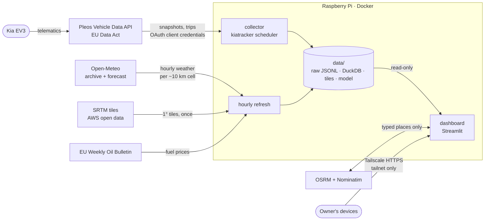

# Architecture

kiatracker collects a Kia EV3's own data through the official EU Data Act API, joins it with weather and
terrain, derives drives and charging sessions, fits a physics-informed consumption model and serves it all in
a Streamlit dashboard (branded *Windrose*). This document describes how the pieces fit; the reasons behind
each choice are in [decisions/](decisions/README.md), the tables in [data-model.md](data-model.md) and the
model in [modelling.md](modelling.md).

## System context



Only the owner's own devices reach the dashboard (Tailscale Serve); its port is published on `127.0.0.1`.

## Data flow

```
                    every 1 min while driving, every 5 min parked
Pleos API ─────────────────────────────────────────▶ data/raw/snapshots-YYYY-MM.jsonl   ┐
                    every 6 h                                 trips-YYYY-MM.jsonl         │ bronze:
                                                              errors-YYYY-MM.jsonl        │ append-only,
                    hourly refresh                                                        │ never edited
Open-Meteo archive/forecast (drive cells) ──────────▶ data/raw/weather-YYYY-MM.jsonl     │
Open-Meteo forecast (home cell) ────────────────────▶ data/raw/forecast-YYYY-MM.jsonl    │
EU Weekly Oil Bulletin (weekly) ────────────────────▶ data/raw/fuel-YYYY-MM.jsonl        ┘
SRTM tiles ─────────────────────────────────────────▶ data/dem/N47E018.hgt …

                                  kiatracker build  (full rebuild, seconds)
                                            │
             silver.py: parse + dedupe      ▼        gold.py / segments.py: derive
                              data/kiatracker.duckdb
                              ├─ readings_battery / _driving / _location / _status / _range
                              ├─ api_trips
                              ├─ drives                (+ quality flag)
                              ├─ drive_segments        (stretch weather + terrain, no coordinates)
                              ├─ charging_sessions, charge_windows
                              ├─ drive_weather, forecast_hourly, fuel_prices
                                            │
                     forecast/: features → fit (NNLS + specs prior) → backtest
                                            │
                              data/models/range.json
                                            │
             dashboard: queries.py → charts.py → views/*  ·  route_energy.py for the Routes page
```

## Runtime

| Process | Command | Schedule | Writes |
|---|---|---|---|
| Collector | `kiatracker scheduler` (Docker service `collector`) | collect: 1 min with ignition on, else 5 min; refresh: hourly, first after 2 min | `data/raw/`, `data/dem/`, the database, the model |
| Refresh (inside the scheduler) | `kiatracker refresh` | hourly | drive and stretch weather, forecast, fuel prices (weekly), terrain tiles, rebuild, retrain |
| Dashboard | `kiatracker dashboard` (service `dashboard`) | always on | nothing (data mounted read-only) |

`schedule.run_jobs` is a small single-threaded loop: each job computes its next run from its result (the
collect job looks at whether the ignition was on), and a failing job is logged and retried at its next slot
without stopping the others. Every network step in `refresh` is best-effort; the rebuild and retraining always
run.

## Code map

```
src/kiatracker/
├─ cli.py             commands: collect, build, weather, refresh, scheduler, train, forecast, route,
│                     stats, demo, dashboard
├─ config.py          Settings from environment / .env (credentials, data dir, home zone)
├─ pleos.py           API client: token, re-login on expiry, typed errors, endpoint paths
├─ collect.py         one poll: dedupe by car timestamp, 6-hourly trip sync, summary without coordinates
├─ schedule.py        Job and run_jobs: the adaptive scheduler
├─ raw.py             append/read monthly JSONL records
├─ silver.py          raw records → typed readings (model.py dataclasses)
├─ gold.py            drives, charging sessions, charge windows, quality flags
├─ segments.py        drive stretches with their own weather and terrain
├─ weather.py         Open-Meteo for drives and stretches, cached as raw records
├─ elevation.py       SRTM tile download and lookup (Terrain)
├─ geo.py             bearing, headwind, airspeed² along a path
├─ privacy.py         haversine distance, home / other zones
├─ prices.py          EU Weekly Oil Bulletin parsing (fuel cost comparison)
├─ db.py              build_database: derive everything, write DuckDB atomically; stats
├─ synthetic.py       simulator with known physics (TRUTH) for demo data and tests
├─ routing.py         geocoding, OSRM routes, ~1 km pieces
├─ route_energy.py    per-piece conditions, energy breakdown, Monte Carlo, route comparison
├─ forecast/
│  ├─ specs.py        car specifications → prior coefficients
│  ├─ features.py     one feature row per drive (from stretches when available)
│  ├─ model.py        RangeModel, non-negative least squares with a ridge pull
│  ├─ evaluate.py     time-ordered backtest against baselines
│  ├─ train.py        pick the pull strength, fit, intervals
│  ├─ scenarios.py    which model to show (fitted vs specs), range grids
│  └─ outlook.py      forecast fetch, daily range outlook
└─ dashboard/
   ├─ app.py          entry point, data source choice, navigation
   ├─ source.py       fail-closed demo / personal decision
   ├─ queries.py      DuckDB → pandas (no Streamlit)
   ├─ charts.py       pandas → Altair in the house style (no Streamlit)
   ├─ ui.py           page header, stat tiles, brand
   └─ views/          overview, drives, charging, costs, range, routes
```

## Cross-cutting concerns

**Privacy.** Coordinates are read by `gold.py`, `segments.py`, `features.py` and `route_energy.py` to derive
zones, headwinds and climbs, and stop there. Queries, feature rows, logs and the collector's summary line carry
none; tests enforce it. The dashboard is demo-only unless explicitly started in personal mode on a local-only
address. See [ADR 0005](decisions/0005-privacy-by-construction.md).

**Time.** Everything is stored in UTC with the car's own timestamps. The dashboard and logs show
Europe/Budapest local time.

**Failure handling.** One failing API group writes an `errors` record and the poll continues; a 429 stops
that poll; token expiry triggers one re-login. A failed weather, forecast, tile or fuel download is skipped
and retried next hour. The build tolerates unknown fields and invalid sentinels (tyre pressure 255 → null).

**Testing.** 247 tests (pytest, respx for HTTP): every derivation rule on hand-made reading sequences, the
model recovering the simulator's true coefficients within 15 %, the backtest, the route pipeline with mocked
OSRM / Nominatim, chart specs, and headless page renders with Streamlit's `AppTest`. CI runs ruff, pytest and
gitleaks; pre-commit runs gitleaks and ruff locally.

**Configuration.** Environment variables or `.env`:

| Variable | Purpose | Default |
|---|---|---|
| `PLEOS_API_KEY_CLIENT_ID`, `PLEOS_API_KEY_CLIENT_SECRET` | Pleos private-user key | required for collecting |
| `KIATRACKER_DATA_DIR` | raw files, database, tiles, model | `./data` (`/data` in Docker) |
| `KIATRACKER_HOME_LAT`, `_LON`, `_RADIUS_KM` | home zone for `home` / `other` labels | unset; radius 0.3 km |
| `KIATRACKER_OSRM_URL` | self-hosted OSRM | public demo server |
| `KIATRACKER_PERSONAL` | personal data in the dashboard (set by `kiatracker dashboard`) | off: demo |
| `KIATRACKER_DEMO` | force demo data whatever else is set | off |
| `KIATRACKER_IN_CONTAINER` | the container's 127.0.0.1 port mapping keeps it local | off |
| `KIATRACKER_NOTEBOOK_DB` | database for the notebook's personal mode | `../data/kiatracker.duckdb` |
